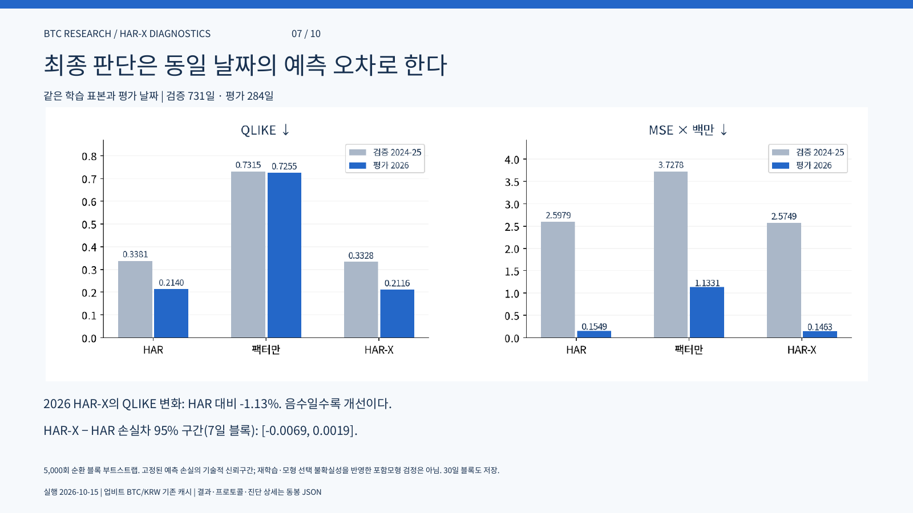

# Bitcoin 변동성 예측

BTC/KRW 변동성 예측에서 거래량과 하락 변동성 정보가 HAR 모형을 개선하는지 비교했습니다.

[보고서 보기](REPORT.md) · [PDF 10쪽](reports/har_factor_study.pdf) · [상세 통계](reports/har_factor_study/results.json) · [분석 코드](scripts/)

## 결과

2026년 평가 구간에서 HAR-X의 QLIKE는 HAR보다 **약 1.13% 낮았습니다**. 다만 손실차의 95% 구간이 [−0.0069, 0.0019]로 0을 포함했습니다. 오차는 소폭 줄었지만 개선이 뚜렷하다고 결론 내리기는 어렵습니다.

QLIKE는 변동성 예측 오차를 평가하는 손실함수로, 낮을수록 좋습니다. 2026년 결과는 이미 관찰한 표본에 대한 사후 평가입니다.

## 데이터와 모형

| 항목 | 설정 |
|---|---|
| 원자료 | Upbit BTC/KRW 1분 시세 |
| 기간 | 완결 UTC 일자 2017-09-26–2026-10-11 |
| 실현변동성 | 5분 수익률 제곱합 |
| 비교 모형 | HAR, 팩터 모형, HAR-X |
| 검증 구간 | 2024–2025년 |
| 평가 구간 | 2026-01-01–2026-10-11 |

HAR는 여러 기간의 과거 변동성을 사용합니다. HAR-X에는 거래량 충격과 하락 변동성 비중을 추가했습니다. 계수의 통계적 관계와 실제 예측 오차 개선을 나누어 확인했습니다.

## 분석 구성

| 구분 | 내용 |
|---|---|
| 데이터 점검 | 관측률·결측, 표본 간격별 실현변동성, 자기상관 |
| 예측 비교 | HAR / HAR-X, 고정 계수와 재추정 |
| 전략 실험 | BTC–현금, 하락 비중 롱숏, 저빈도 오버레이 |
| 데이터 수집 | 별도 [Market Data API](https://github.com/Kimjongyeop-web/market-data-api) |

전략 실험은 예측 모형 비교와 별도입니다. 예측 오차 감소를 거래 수익률 개선으로 해석하지 않습니다.

## 재현 경로

입력은 `work/minute_cache/`의 월별 원응답, `download_meta.json`, `progress.json`입니다. 원자료는 공개 저장소에 포함하지 않습니다.

1. `analyze_minutes.py` — 분봉 자료 분석
2. `run_har_factor_study.py` — 모형 비교
3. `report_har_factor_study.py` — 보고서 작성
4. `check_har_factor_study.py` — 결과 점검

전략별 스크립트는 별도의 선행 입력을 요구합니다. 보고서 생성에는 외부 렌더러와 글꼴도 필요합니다.

`python prepare_run.py --run-id research_001`은 실행별 소스 복사본과 빈 작업 폴더를 만듭니다. 전체 분석을 새 환경에서 재실행하는 검증은 아직 완료하지 않았습니다.

[보고서 주요 페이지](REPORT.md) · [데이터 범위와 재현 조건](DATA_POLICY.md)
